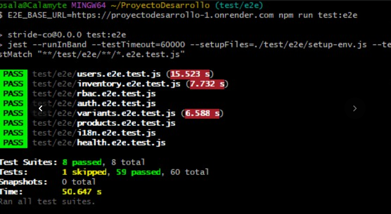

# Stride & Co. — Backend de tienda deportiva

**Proyecto Integrador · Entregable 2 · Desarrollo de Aplicaciones Web**

**Repositorio:** https://github.com/CarlosGlezCar/ProyectoDesarrollo

**Rama de entrega:** `staging`

**API pública:** https://proyectodesarrollo-1.onrender.com

**Health Check:** https://proyectodesarrollo-1.onrender.com/health

> **Estado del proyecto:** se confirmó la conexión a PostgreSQL y MongoDB Atlas, la ejecución del seed, el inicio de sesión con JWT, controles básicos de RBAC, internacionalización en español e inglés y 293 pruebas locales aprobadas.

---

## 1. Descripción del proyecto

Stride & Co. es el backend de una tienda deportiva desarrollado para administrar productos, variantes, inventario, clientes, pedidos y usuarios mediante una API REST.

El sistema utiliza autenticación mediante JSON Web Tokens (JWT), control de acceso basado en roles (RBAC), internacionalización y persistencia en bases de datos relacionales y documentales.

### Integrantes del equipo

| Integrante | Rol |
|---|---|
| José Fernando Martínez Pacheco | Product Owner |
| Elio Castillo Reyes | Scrum Master |
| Carlos González Carrera | Developer |
| Bruno Salazar Carrillo | Developer |

### Tecnologías utilizadas

| Componente | Tecnología |
|---|---|
| Backend | Node.js 22 y Express |
| Autenticación | JWT, express-jwt y bcrypt |
| Autorización | AccessControl y RBAC |
| Base de datos relacional | PostgreSQL |
| ORM | Sequelize |
| Base de datos documental | MongoDB Atlas |
| ODM | Mongoose |
| Internacionalización | i18n |
| Configuración | node-config |
| Vistas | Pug |
| Pruebas | Jest y Supertest |
| Calidad del código | ESLint |
| Contenedores | Docker |
| Despliegue | Render |
| Control de versiones | Git y GitHub |
| Pruebas | Jest, Supertest, Google Antigravity |

---

## 2. Arquitectura del sistema

El backend está construido sobre Express y utiliza dos bases de datos.

**PostgreSQL** almacena los datos relacionales:

- Usuarios.
- Roles.
- Permisos.
- Productos.
- Variantes.
- Inventario.

**MongoDB Atlas** almacena los datos documentales:

- Clientes.
- Órdenes o pedidos.

La aplicación utiliza Sequelize para PostgreSQL y Mongoose para MongoDB.

### Flujo de las solicitudes

```text
Cliente HTTP
    |
    v
Express
    |
    v
Internacionalización (i18n)
    |
    v
Router
    |
    v
Autenticación JWT
    |
    v
Autorización RBAC
    |
    v
Controller
    |
    +-------------------+
    |                   |
    v                   v
Sequelize           Mongoose
    |                   |
    v                   v
PostgreSQL         MongoDB Atlas
    |                   |
    +---------+---------+
              |
              v
       Respuesta JSON
       { message, data }
```

La autenticación comprueba la identidad del usuario, mientras que la autorización verifica sus permisos antes de ejecutar las operaciones.

---

## 3. Instalación desde cero

### Requisitos previos

Para ejecutar el proyecto se necesita:

- Node.js 22.
- npm.
- Git.
- PostgreSQL.
- MongoDB local o MongoDB Atlas.
- Docker, opcional para desarrollo local.

### 3.1. Clonar el repositorio

```bash
git clone https://github.com/CarlosGlezCar/ProyectoDesarrollo.git
```

Entrar a la carpeta:

```bash
cd ProyectoDesarrollo
```

Seleccionar la rama de entrega:

```bash
git switch staging
```

### 3.2. Instalar dependencias

```bash
npm ci
```

Este comando instala las dependencias definidas en `package-lock.json`.

### 3.3. Crear la configuración local

El proyecto utiliza la biblioteca `config` para administrar las configuraciones y los secretos.

Crear una copia del archivo de ejemplo:

```bash
cp config/local-development.example.json config/local-development.json
```

En Windows PowerShell se puede utilizar:

```powershell
Copy-Item config/local-development.example.json config/local-development.json
```

Editar `config/local-development.json` con las credenciales locales.

Ejemplo de estructura:

```json
{
  "jwt": {
    "secret": "REEMPLAZAR_CON_UNA_CLAVE_ALEATORIA_LARGA"
  },
  "database": {
    "postgres": {
      "password": "CONTRASENA_LOCAL_POSTGRESQL"
    },
    "mongo": {
      "uri": "mongodb://127.0.0.1:27017/stride_co"
    }
  }
}
```

Los valores mostrados son ejemplos. Cada desarrollador debe utilizar sus propias credenciales.

El archivo contiene secretos y no debe subirse al repositorio.

### 3.4. Configurar PostgreSQL

Crear una base de datos llamada:

```text
stride_co
```

Configurar un usuario con permisos sobre dicha base.

Los parámetros generales de conexión se encuentran en `config/default.json`.

En desarrollo, PostgreSQL utiliza normalmente el puerto `5432`.

### 3.5. Configurar MongoDB

Para desarrollo puede utilizarse una instancia local de MongoDB o un clúster de MongoDB Atlas.

La URI correspondiente debe configurarse en el archivo privado `config/local-development.json`.

### 3.6. Iniciar el servidor

```bash
npm start
```

La aplicación inicia por defecto en:

```text
http://localhost:3000
```

Para comprobar el funcionamiento del servidor:

```bash
curl http://localhost:3000/health
```

Respuesta esperada:

```json
{
  "status": "UP"
}
```

Para desarrollo con reinicio automático se puede ejecutar:

```bash
npm run dev
```

### 3.7. Ejecutar los datos iniciales

El proyecto dispone de un script que crea los registros necesarios para las pruebas y demostraciones.

```bash
npm run seed
```

El script `scripts/seed.js` prepara:

- Roles `ADMIN`, `SALES` y `USER`.
- Permisos asociados a los roles.
- Usuarios de demostración.
- Productos y variantes.
- Registros de inventario.
- Clientes.
- Órdenes de ejemplo.

Antes de ejecutar el seed sobre una base compartida, se recomienda verificar su comportamiento y respaldar los datos importantes.

---

## 4. Configuración y secretos

La aplicación utiliza `config` para administrar las propiedades de cada entorno.

Los entornos contemplados son:

| Entorno | Descripción |
|---|---|
| `development` | Desarrollo local |
| `test` | Pruebas automatizadas |
| `production` | Despliegue en Render |

### Archivos de configuración

| Archivo | Descripción | Git |
|---|---|---|
| `config/default.json` | Configuración general | Sí |
| `config/development.json` | Configuración pública de desarrollo, si existe | Sí |
| `config/test.json` | Configuración de pruebas | Sí |
| `config/production.json` | Configuración pública de producción | Sí |
| `config/custom-environment-variables.json` | Mapeo de variables de entorno | Sí |
| `config/local-development.example.json` | Plantilla de configuración | Sí |
| `config/local-development.json` | Secretos de desarrollo | No |
| `config/local-production.json` | Secretos de producción | No |

### Variables de entorno

Las variables de entorno previstas para la aplicación son:

**NODE_ENV**

Selecciona el entorno de ejecución.

```text
development
test
production
```

**PORT**

Define el puerto utilizado por el servidor HTTP.

Render proporciona este valor durante el despliegue.

La configuración de `PORT` se realiza mediante `config/custom-environment-variables.json`.

### Configuración de producción

Para el despliegue se utiliza un archivo privado llamado:

```text
config/local-production.json
```

Su estructura es:

```json
{
  "jwt": {
    "secret": "CLAVE_JWT_PRIVADA"
  },
  "database": {
    "postgres": {
      "url": "URL_INTERNA_PRIVADA_POSTGRESQL",
      "ssl": false
    },
    "mongo": {
      "uri": "URI_PRIVADA_MONGODB_ATLAS"
    }
  }
}
```

Las credenciales y URL privadas nunca deben almacenarse en GitHub.

### Entrega de secretos a Render

En el Web Service de Render se utiliza:

```text
Environment → Secret Files
```

Se crea un archivo llamado:

```text
local-production.json
```

Render lo monta en:

```text
/etc/secrets/local-production.json
```

El Dockerfile configura el acceso a ese archivo desde el directorio de configuración de la aplicación.

De esta manera, las contraseñas y claves privadas permanecen fuera del repositorio y de la imagen Docker.

---

## 5. API REST y endpoints

**URL base:**

https://proyectodesarrollo-1.onrender.com

La API trabaja con solicitudes y respuestas JSON.

Las rutas protegidas requieren un token JWT mediante el encabezado:

```http
Authorization: Bearer TOKEN_JWT
```

### Rutas públicas y autenticación

| Método | Endpoint | Descripción | Permiso |
|---|---|---|---|
| GET | `/` | Página principal | Público |
| GET | `/health` | Estado del servidor | Público |
| POST | `/api/auth/login` | Inicio de sesión | Público |
| GET | `/api/auth/me` | Consultar usuario autenticado | JWT |

### Usuarios

| Método | Endpoint | Descripción | Permiso |
|---|---|---|---|
| POST | `/api/users` | Crear usuario | `users:create:any` |
| GET | `/api/users` | Listar usuarios | `users:read:any` |
| GET | `/api/users/:id` | Consultar usuario | `users:read:any` |
| PUT | `/api/users/:id` | Actualizar usuario | `users:update:any` |
| DELETE | `/api/users/:id` | Eliminar usuario | `users:delete:any` |

### Roles

| Método | Endpoint | Descripción | Permiso |
|---|---|---|---|
| POST | `/api/roles` | Crear rol | `roles:create:any` |
| GET | `/api/roles` | Listar roles | `roles:read:any` |
| GET | `/api/roles/:id` | Consultar rol | `roles:read:any` |
| PUT | `/api/roles/:id` | Actualizar rol | `roles:update:any` |
| DELETE | `/api/roles/:id` | Eliminar rol | `roles:delete:any` |

### Permisos

| Método | Endpoint | Descripción | Permiso |
|---|---|---|---|
| POST | `/api/permissions` | Crear permiso | `permissions:create:any` |
| GET | `/api/permissions` | Listar permisos | `permissions:read:any` |
| GET | `/api/permissions/:id` | Consultar permiso | `permissions:read:any` |
| PUT | `/api/permissions/:id` | Actualizar permiso | `permissions:update:any` |
| DELETE | `/api/permissions/:id` | Eliminar permiso | `permissions:delete:any` |

### Productos

| Método | Endpoint | Descripción | Permiso |
|---|---|---|---|
| POST | `/api/products` | Crear producto | `products:create:any` |
| GET | `/api/products` | Listar productos | `products:read:any` |
| GET | `/api/products/:id` | Consultar producto | `products:read:any` |
| PUT | `/api/products/:id` | Actualizar producto | `products:update:any` |
| DELETE | `/api/products/:id` | Eliminar producto | `products:delete:any` |

### Variantes

| Método | Endpoint | Descripción | Permiso |
|---|---|---|---|
| POST | `/api/variants` | Crear variante | `variants:create:any` |
| GET | `/api/variants` | Listar variantes | `variants:read:any` |
| GET | `/api/variants/:id` | Consultar variante | `variants:read:any` |
| PUT | `/api/variants/:id` | Actualizar variante | `variants:update:any` |
| DELETE | `/api/variants/:id` | Eliminar variante | `variants:delete:any` |

### Inventario

| Método | Endpoint | Descripción | Permiso |
|---|---|---|---|
| POST | `/api/inventory` | Crear registro | `inventory:create:any` |
| GET | `/api/inventory` | Listar inventario | `inventory:read:any` |
| GET | `/api/inventory/:id` | Consultar inventario | `inventory:read:any` |
| PUT | `/api/inventory/:id` | Actualizar inventario | `inventory:update:any` |
| DELETE | `/api/inventory/:id` | Eliminar registro | `inventory:delete:any` |

### Clientes

| Método | Endpoint | Descripción | Permiso |
|---|---|---|---|
| POST | `/api/customers` | Crear cliente | `customers:create:any` |
| GET | `/api/customers` | Listar clientes | `customers:read:own` o `customers:read:any` |
| GET | `/api/customers/:id` | Consultar cliente | `customers:read:own` o `customers:read:any` |
| PUT | `/api/customers/:id` | Actualizar cliente | `customers:update:any` |
| DELETE | `/api/customers/:id` | Eliminar cliente | `customers:delete:any` |

### Órdenes

| Método | Endpoint | Descripción | Permiso |
|---|---|---|---|
| POST | `/api/orders` | Crear orden | `orders:create:own` o `orders:create:any` |
| GET | `/api/orders` | Listar órdenes | `orders:read:own` o `orders:read:any` |
| GET | `/api/orders/:id` | Consultar orden | `orders:read:own` o `orders:read:any` |
| PUT | `/api/orders/:id` | Actualizar orden | `orders:update:own` o `orders:update:any` |
| DELETE | `/api/orders/:id` | Eliminar orden | `orders:delete:own` o `orders:delete:any` |

Las rutas con permisos `ownOrAny` aplican el alcance autorizado para cada usuario y verifican la pertenencia del recurso cuando corresponde.

### Formato de respuesta

Las respuestas siguen la estructura:

```json
{
  "message": "Mensaje traducido",
  "data": {}
}
```

### Códigos HTTP

| Código | Significado |
|---|---|
| 200 | Operación correcta |
| 201 | Recurso creado |
| 400 | Datos inválidos |
| 401 | Token ausente, inválido o expirado |
| 403 | Acceso denegado por permisos |
| 404 | Recurso no encontrado |
| 500 | Error interno del servidor |

La API no debe devolver contraseñas, hashes ni claves de seguridad.

---

## 6. Control de acceso basado en roles (RBAC)

El sistema implementa autorización mediante roles y permisos.

La información de autorización se obtiene de PostgreSQL a través de las relaciones entre:

```text
Role
 |
 v
RolePermission
 |
 v
Permission
```

La biblioteca AccessControl permite evaluar las acciones autorizadas.

### Convención de permisos

Los permisos utilizan el formato:

```text
recurso:accion:alcance
```

Ejemplos:

```text
products:read:any
products:delete:any
orders:read:own
orders:read:any
```

### Alcances

**own:** permite trabajar únicamente con recursos pertenecientes al usuario autenticado.

**any:** permite trabajar con los recursos del sistema dentro de las acciones autorizadas.

Para las órdenes, el acceso `own` requiere comprobar que la orden pertenezca al usuario correspondiente.

### Roles

El sistema utiliza tres roles:

**ADMIN:** administrador del sistema.

**SALES:** encargado de ventas.

**USER:** usuario general.

### Matriz RBAC

Esta matriz corresponde a los permisos declarados en el seed del proyecto.

| Recurso | ADMIN | SALES | USER |
|---|---|---|---|
| Users | CRUD any | Sin acceso | Sin acceso |
| Roles | CRUD any | Sin acceso | Sin acceso |
| Permissions | CRUD any | Sin acceso | Sin acceso |
| Products | CRUD any | Read any | Read any |
| Variants | CRUD any | Read any | Read any |
| Inventory | CRUD any | Read y Update any | Read any |
| Customers | CRUD any | Read y Update any | Read own |
| Orders | CRUD any | Create, Read y Update any | Create, Read y Update own |

### Verificaciones realizadas

Se ejecutaron pruebas de autorización directamente contra la API de Render.

**Prueba 1: solicitud sin token**

```http
GET /api/products
```

Resultado:

```http
401 Unauthorized
```

Respuesta:

```json
{
  "message": "Se requiere un token de autenticación",
  "data": null
}
```

**Prueba 2: SALES consulta productos**

```http
GET /api/products
Authorization: Bearer TOKEN_SALES
```

Resultado:

```http
200 OK
```

**Prueba 3: SALES consulta usuarios**

```http
GET /api/users
Authorization: Bearer TOKEN_SALES
```

Resultado:

```http
403 Forbidden
```

Respuesta:

```json
{
  "message": "Acceso denegado",
  "data": null
}
```

Estas pruebas confirman el funcionamiento básico de autenticación y autorización en producción.

La cobertura completa de permisos y operaciones CRUD se comprueba mediante la suite E2E (rbac.e2e.test.js, con los cinco escenarios de rol)

---

## 7. Internacionalización (i18n)

La aplicación implementa internacionalización mediante la biblioteca `i18n`.

Los idiomas disponibles son:

- Español: `es`.
- Inglés: `en`.

Los archivos de traducción se encuentran en:

```text
locales/
├── es.json
└── en.json
```
También hay una suite E2E (i18n.e2e.test.js) que prueba es, en, es-MX, fr y la prioridad de ?lang.

### Selección de idioma

El idioma se determina utilizando el siguiente orden de prioridad:

1. Parámetro `?lang`.
2. Encabezado `Accept-Language`.
3. Idioma predeterminado: español.

Por ejemplo:

```http
GET /api/products?lang=es
```

Devuelve:

```json
{
  "message": "Productos obtenidos correctamente",
  "data": []
}
```

Mientras que:

```http
GET /api/products?lang=en
```

Devuelve:

```json
{
  "message": "Products retrieved successfully",
  "data": []
}
```

Los arreglos vacíos mostrados son ilustrativos; los datos reales dependen de los registros almacenados.

### Variantes regionales

Las variantes regionales se interpretan mediante su idioma base.

Por ejemplo:

```http
GET /api/products?lang=es-MX
```

Responde en español.

### Idiomas no soportados

Si se solicita un idioma no disponible, se utiliza español como idioma predeterminado.

Ejemplo:

```http
GET /api/products?lang=fr
```

Resultado comprobado:

```json
{
  "message": "Productos obtenidos correctamente",
  "data": []
}
```

### Prioridad del parámetro sobre el encabezado

Se comprobó una solicitud con:

```http
GET /api/products?lang=es
Accept-Language: en
```

La respuesta apareció en español, confirmando la prioridad del parámetro `lang`.

### Resultados de las pruebas en producción

| Prueba | Resultado | Estado |
|---|---|---|
| `?lang=es` | Español, HTTP 200 | Correcto |
| `?lang=en` | Inglés, HTTP 200 | Correcto |
| `?lang=es-MX` | Español, HTTP 200 | Correcto |
| `Accept-Language: en` | Inglés, HTTP 200 | Correcto |
| `?lang=es` y encabezado inglés | Español, HTTP 200 | Correcto |
| `?lang=fr` | Español, HTTP 200 | Correcto |

### Pruebas automáticas de traducción

Se agregó el archivo:

```text
test/i18n-paridad.test.js
```

Este archivo comprueba:

- Que `es.json` y `en.json` tengan las mismas claves.
- Que las traducciones no estén vacías.

Para ejecutarlo:

```bash
npx jest --runInBand test/i18n-paridad.test.js
```

Resultado obtenido:

```text
PASS test/i18n-paridad.test.js

Test Suites: 1 passed, 1 total
Tests:       2 passed, 2 total
```

### Agregar un idioma

Para incorporar otro idioma:

1. Crear un archivo JSON dentro de `locales/`.
2. Utilizar las mismas claves que los idiomas existentes.
3. Registrar el idioma en la configuración de i18n.
4. Actualizar las pruebas de traducción.
5. Verificar su funcionamiento mediante `?lang`.

---

## 8. API pública y despliegue

### Información general

| Dato | Información |
|---|---|
| Plataforma | Render |
| Servicio | Web Service |
| Tecnología | Docker y Node.js 22 |
| Rama desplegada | `staging` |
| URL | https://proyectodesarrollo-1.onrender.com |
| Health Check | `/health` |
| Base relacional | Render PostgreSQL |
| Base documental | MongoDB Atlas |

### PostgreSQL de Render

| Campo | Información |
|---|---|
| Servicio | Render PostgreSQL |
| Región | Oregon (US West) |
| Fecha de creación | 03/11/2026 |
| Plan | Free |
| ORM | Sequelize |

La base de datos PostgreSQL almacena los usuarios, roles, permisos, productos, variantes e inventario.

El plan gratuito de PostgreSQL tiene una vigencia limitada. Se debe comprobar que la instancia esté activa al momento de la evaluación.

### MongoDB Atlas

| Campo | Información |
|---|---|
| Clúster | Cluster0 |
| Proveedor | AWS |
| Región | Oregon (`us-west-2`) |
| Plan | Free |
| ODM | Mongoose |
| Network Access | `0.0.0.0/0` |

La configuración de Network Access permite las conexiones desde Render, cuya dirección de salida puede variar.

Debido a que se permite el acceso desde cualquier IP, se utilizan credenciales privadas para proteger la conexión.

La URI de MongoDB no se publica en el repositorio.

### Usuarios de demostración

Los usuarios son ficticios y se utilizan exclusivamente para comprobar el sistema.

| Rol | Correo | Contraseña de demostración |
|---|---|---|
| ADMIN | `admin@strideco.test` | `Admin123!` |
| SALES | `ventas@strideco.test` | `Ventas123!` |
| USER | `usuario@strideco.test` | `Usuario123!` |

Se comprobó el inicio de sesión de ADMIN y SALES contra Render. La cuenta USER está definida en el seed, el login de USER ya lo cubre la E2E contra Render.

Estas contraseñas son exclusivamente de demostración y no deben reutilizarse en servicios personales.

### Ejemplo de inicio de sesión

```bash
curl -X POST "https://proyectodesarrollo-1.onrender.com/api/auth/login" -H "Content-Type: application/json" -H "Accept-Language: es" -d '{"email":"admin@strideco.test","password":"Admin123!"}'
```

Ejemplo de respuesta:

```json
{
  "message": "Inicio de sesión exitoso",
  "data": {
    "token": "TOKEN_JWT_GENERADO",
    "tokenType": "Bearer",
    "expiresIn": "15m"
  }
}
```

El token tiene una duración de 15 minutos.

### Consultar un recurso protegido

Con un token válido:

```bash
curl "https://proyectodesarrollo-1.onrender.com/api/products?lang=es" -H "Authorization: Bearer TU_TOKEN_JWT"
```

La API devuelve los productos disponibles si el usuario tiene el permiso correspondiente.

### Ejemplo de acceso denegado

Un usuario SALES no tiene autorización para consultar todos los usuarios del sistema.

```bash
curl "https://proyectodesarrollo-1.onrender.com/api/users?lang=es" -H "Authorization: Bearer TOKEN_SALES"
```

Resultado esperado y comprobado:

```http
403 Forbidden
```

```json
{
  "message": "Acceso denegado",
  "data": null
}
```

---

## 9. Pruebas automatizadas

El proyecto utiliza ESLint, Jest y Supertest.

### 9.1. Análisis de código

```bash
npm run lint
```

Resultado comprobado:

```text
eslint .
```

El comando terminó sin errores.

### 9.2. Pruebas con Jest (mocks)

```bash
npm test
```

Estas pruebas **no necesitan bases de datos ni secretos**: los modelos de Sequelize y Mongoose se sustituyen con mocks (`jest.spyOn`) y la sesión se simula con los helpers de `test/helpers/`. Excluyen `test/e2e/`, que se ejecuta aparte (sección 9.3).

Cubren todos los recursos (usuarios, roles, permisos, productos, variantes, inventario, clientes y órdenes) y los casos transversales:

- Autenticación: token ausente, inválido y expirado.
- Autorización RBAC por rol y alcance (`own` y `any`).
- Validaciones (400) y recursos inexistentes (404).
- Que no se devuelvan contraseñas ni hashes.
- Internacionalización en español e inglés, y paridad de `es.json` y `en.json`.
- Configuración.

Resultado obtenido:

```text
Test Suites: 15 passed, 15 total
Tests:       293 passed, 293 total
Snapshots:   0 total
```

Para ejecutar un solo archivo:

```bash
npx jest --runInBand test/roles.test.js
```

### 9.3. Pruebas E2E

Las pruebas end-to-end usan Jest y Supertest contra una API en ejecución y sus bases de datos reales. Crean datos con el prefijo `E2E` y los eliminan al terminar.

```text
test/e2e/
├── setup-env.js
├── helpers.js
├── health.e2e.test.js
├── auth.e2e.test.js
├── rbac.e2e.test.js
├── i18n.e2e.test.js
├── users.e2e.test.js
├── roles.e2e.test.js
├── permissions.e2e.test.js
├── products.e2e.test.js
├── variants.e2e.test.js
├── inventory.e2e.test.js
├── customers.e2e.test.js
└── orders.e2e.test.js
```

**Cobertura:** ciclo CRUD hasta 404, login, token ausente, inválido y expirado, los cinco escenarios RBAC, relaciones entre modelos, errores 400, ausencia de datos sensibles y respuestas en `es` y `en`.

**Ejecución local** (con la API encendida con `npm start`):

```bash
npm run test:e2e
```

**Ejecución contra Render.** La URL se toma de `e2e.baseUrl` en `config/default.json`, o de la variable `E2E_BASE_URL`, que solo usa el runner E2E.

Git Bash:

```bash
E2E_BASE_URL=https://proyectodesarrollo-1.onrender.com npm run test:e2e
```

PowerShell:

```powershell
$env:E2E_BASE_URL="https://proyectodesarrollo-1.onrender.com"; npm run test:e2e
```

La prueba del token expirado necesita el mismo secreto JWT que la API, por lo que se omite contra Render (aparece como 1 prueba omitida).

La primera solicitud a Render puede tardar por la suspensión del plan gratuito; el runner usa un timeout de 60 s.

**Resultado contra Render:**



**Diferencia con `npm test`:** `npm test` corre solo las pruebas con mocks y no requiere bases de datos ni secretos. Las E2E son independientes y se ejecutan con `npm run test:e2e`.

### Evidencia de Antigravity

La generación y revisión del código de las pruebas E2E se documentará en:

```text
docs/e2e-antigravity.md
```

Este documento deberá incluir los prompts utilizados, los cambios realizados por el equipo y la evidencia solicitada de la sesión con la cuenta institucional.

También deberá incluirse una captura de la ejecución de `npm run test:e2e` contra Render.

---

## 10. Despliegue con Docker y Render

El backend está desplegado como un Web Service de Render utilizando Docker.

### Configuración del servicio

| Parámetro | Valor |
|---|---|
| Repositorio | `CarlosGlezCar/ProyectoDesarrollo` |
| Rama | `staging` |
| Entorno | Docker |
| Node.js | 22 |
| NODE_ENV | `production` |
| Puerto | Proporcionado por Render |
| Health Check Path | `/health` |

### Procedimiento de despliegue

1. Conectar el repositorio de GitHub a Render.
2. Seleccionar la rama `staging`.
3. Crear el Web Service utilizando el Dockerfile.
4. Configurar `NODE_ENV=production`.
5. Crear PostgreSQL en Render.
6. Configurar MongoDB Atlas.
7. Agregar `local-production.json` mediante Secret Files.
8. Configurar `/health` como Health Check Path.
9. Desplegar la aplicación.
10. Verificar los logs de conexión y el inicio del servidor.
11. Ejecutar el seed de producción.
12. Comprobar los endpoints públicos y protegidos.

### Resultados del despliegue

Durante el arranque se obtuvieron los siguientes mensajes:

```text
Conectando a MongoDB...
MongoDB Atlas conectado correctamente
MongoDB conectado
URL de PostgreSQL configurada: true
Conectando a PostgreSQL...
PostgreSQL conectado
Sincronizando tablas...
Tablas sincronizadas
Servidor escuchando en puerto 10000
```

Esto confirmó la conexión con ambas bases de datos y el inicio del servidor HTTP.

Posteriormente se verificó el funcionamiento de los endpoints de login, productos y control de acceso desde la URL pública.

### Consideraciones del plan gratuito

El Web Service gratuito de Render puede suspenderse por inactividad.

Por ello, la primera solicitud después de un periodo sin tráfico puede tardar más tiempo.

PostgreSQL gratuito tiene una vigencia limitada, por lo que se debe revisar su estado antes de la evaluación.

---

## 11. Estado del Entregable 2

### Actividades completadas

- [x] Configuración del backend mediante `config`.
- [x] Separación de configuraciones públicas y secretos.
- [x] Despliegue Docker en Render.
- [x] Conexión con PostgreSQL.
- [x] Conexión con MongoDB Atlas.
- [x] Ejecución del seed de demostración.
- [x] Inicio de sesión con JWT en producción.
- [x] Verificación básica de permisos RBAC.
- [x] Traducciones en español e inglés.
- [x] Reconocimiento de `es-MX`.
- [x] Prioridad de `?lang` sobre `Accept-Language`.
- [x] Fallback al español con `?lang=fr`.
- [x] Pruebas automáticas de paridad de traducciones.
- [x] `npm run lint` sin errores.
- [x] `npm test` con 293 pruebas correctas.
- [x] Documentación de PostgreSQL y MongoDB Atlas.
- [x] Documentación de la URL pública de Render.
- [x] Integración de la suite de pruebas E2E.
- [x] Incorporación del comando `npm run test:e2e`.
- [x] Documentación de Antigravity en `docs/e2e-antigravity.md`.
- [x] Captura de las pruebas E2E ejecutadas contra Render.
- [x] Verificación del login del usuario USER.
- [x] Verificación completa del CRUD y sus validaciones.
- [x] Revisión final de secretos y vigencia de PostgreSQL.

### Actividades pendientes de comprobación

---

## 12. Referencias

- [Render](https://render.com/)
- [Documentación de Render](https://render.com/docs)
- [Sequelize](https://sequelize.org/)
- [Mongoose](https://mongoosejs.com/)
- [MongoDB Atlas](https://www.mongodb.com/atlas)
- [Node.js](https://nodejs.org/)
- [Express](https://expressjs.com/)
- [AccessControl](https://www.npmjs.com/package/accesscontrol)
- [i18n](https://www.npmjs.com/package/i18n)
- [Node-config](https://github.com/node-config/node-config)
- [Jest](https://jestjs.io/)
- [Supertest](https://www.npmjs.com/package/supertest)
- [Conventional Commits](https://www.conventionalcommits.org/)

---

**Universidad Autónoma de Chihuahua — Desarrollo de Aplicaciones Web — Proyecto Integrador, Entregable 2.**