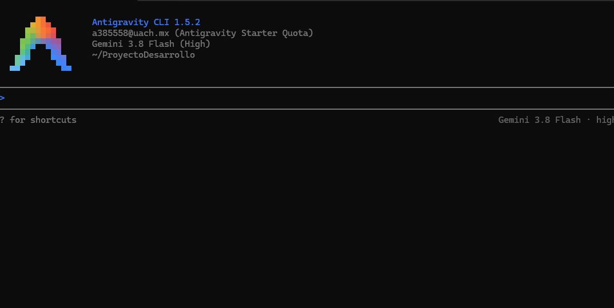

# Pruebas E2E generadas con Google Antigravity

## Cómo se usó
- Herramienta: Google Antigravity, desde la terminal.
- Cuenta: institucional de la UACH.
- Regla: el agente solo escribe el código de las pruebas; el equipo revisa cada archivo antes del commit.

### Captura de la sesión

### Prompt 1:
**Prompt:**
> <Estoy en el repositorio de una API Express (Stride & Co). Lee test/e2e/helpers.js, app.js, routes/index.js y controllers/index.js.
Crea el archivo test/e2e/health.e2e.test.js con Jest + Supertest, sin mocks, contra la API en ejecución, usando la función api() de helpers.js.
Debe comprobar que GET /health responde 200, que el body es exactamente {"status":"UP"} y que no requiere token.
Usa expect reales en cada prueba. No modifiques ningún otro archivo. No leas ni abras config/local-*.json.
>

**Qué generó el agente:** <3 pruebas de `GET /health` en `test/e2e/health.e2e.test.js`>

### Prompt 2:
**Prompt:**
> <Lee test/e2e/helpers.js, test/e2e/health.e2e.test.js (como ejemplo de estilo), routes/auth.js, controllers/auth.js, middlewares/authenticate.js, middlewares/error-handler.js y locales/es.json.
Crea test/e2e/auth.e2e.test.js con Jest + Supertest, sin mocks, contra la API en ejecución, usando api(), login() y bearer() de helpers.js. En las peticiones donde compares mensajes, envía el encabezado Accept-Language: es.
Debe comprobar:
1. POST /api/auth/login con el usuario ADMIN de CREDENTIALS responde 200, con data.token (string no vacío) y data.tokenType igual a "Bearer".
2. La respuesta del login no contiene password, password_hash ni salt_key.
3. Login con contraseña incorrecta responde 401 con el mensaje de auth.invalidCredentials.
4. Login con correo inexistente responde 401 con el mismo mensaje.
5. Login sin body o sin contraseña responde 400.
6. GET /api/auth/me sin token responde 401 con el mensaje de auth.tokenRequired.
7. GET /api/auth/me con el token "abc.def.ghi" responde 401 con el mensaje de auth.invalidToken.
8. GET /api/auth/me con un token bien formado pero firmado con otro secreto (usa jsonwebtoken y el secreto "otro-secreto") responde 401 con el mensaje de auth.invalidToken.
9. GET /api/auth/me con el token de ADMIN responde 200, devuelve el correo admin@strideco.test y no contiene password, password_hash ni salt_key.
Lee los mensajes esperados de locales/es.json en lugar de escribirlos a mano. Haz el login en un beforeAll, una sola vez. Usa expect reales en cada prueba. No modifiques ningún otro archivo. No leas ni abras config/local-*.json.>

**Qué generó el agente:** < 9 casos de login y /me; antes de escribirlos probó un token con otro secreto contra tu API.>

**Qué corrigió el equipo y por qué:** <el caso 5 se dividió en dos pruebas y ahora verifica el mensaje; se agregó una revisión por expresión regular sobre toda la respuesta; se acortó un nombre. Y se rompieron pruebas a propósito para confirmar que fallan.>

### Prompt 3:
**Prompt:**
> <Lee test/e2e/auth.e2e.test.js, test/e2e/helpers.js, controllers/auth.js, middlewares/authenticate.js, middlewares/error-handler.js y locales/es.json.
Agrega a test/e2e/auth.e2e.test.js, dentro del describe de GET /api/auth/me, una prueba de token expirado.
La prueba debe firmar con jsonwebtoken un token con sub '1', algoritmo HS256, expiresIn '-10s', issuer y audience tomados de config.get('jwt.issuer') y config.get('jwt.audience'), y el secreto de config.get('jwt.secret') usando el módulo config (require('config')). No abras ni leas config/local-*.json: el módulo config los lee en tiempo de ejecución.
Debe responder 401 con el mensaje de es.auth.tokenExpired, enviando Accept-Language: es.
Como el secreto de producción no se conoce, la prueba debe omitirse cuando isRemote (de helpers.js) sea true, usando una variable como const testLocal = isRemote ? test.skip : test.
Usa expect reales. No modifiques otros archivos ni otras pruebas.

Generó el agente: la prueba de token expirado (firma con expiresIn: '-10s', issuer, audience y secreto desde config), con testLocal que se omite contra Render.
Preparacion: se creó setup-env.js para que el runner E2E use la configuración development con el mismo secreto que la API, se agregó isRemote en helpers.js, y se rompió la prueba a propósito (token vigente y mensaje distinto) para confirmar que falla.>

**Qué generó el agente:** <la prueba de token expirado. Firma el token con `expiresIn: '-10s'`, con issuer, audience y secreto tomados de `config`. Usa `testLocal`, que la omite contra Render.>

### Prompt 4:
**Prompt:**
> <Lee test/e2e/helpers.js, test/e2e/auth.e2e.test.js (como ejemplo de estilo), routes/products.js, routes/orders.js, controllers/products.js, controllers/orders.js, models/sql/Product.js, middlewares/authorize.js, scripts/seed.js (solo la matriz de permisos, los clientes y las órdenes) y locales/es.json.
Crea test/e2e/rbac.e2e.test.js con Jest + Supertest, sin mocks, contra la API en ejecución, usando api(), login(), bearer() y CREDENTIALS de helpers.js, y Accept-Language: es.
En un beforeAll, haz login de ADMIN, SALES y USER, y con ADMIN obtén de GET /api/orders el id de la orden del cliente cuyo customerId.email es el de USER y el de la orden del cliente cuyo email es el de SALES.
Para los casos de productos, ADMIN crea su propio producto de prueba con nombre único (por ejemplo "E2E RBAC " más Date.now()) y campos válidos según controllers/products.js y el modelo. No borres ni modifiques los productos del seed. En un afterAll, ADMIN borra el producto de prueba si todavía existe.
Debe comprobar:
1. ADMIN DELETE /api/products/:id sobre su producto de prueba responde 200, y después GET del mismo id responde 404.
2. SALES DELETE /api/products/:id sobre un producto de prueba responde 403 con el mensaje de common.forbidden, y después ADMIN comprueba con GET que el producto sigue existiendo (200).
3. USER GET /api/orders/:id con su propia orden responde 200 y data.customerId.email es el correo de USER.
4. USER GET /api/orders/:id con la orden del cliente de SALES responde 403 con el mensaje de common.forbidden.
5. USER GET /api/orders (orders:read:any) responde 403 con el mensaje de common.forbidden.
6. SALES GET /api/orders responde 200.
7. USER GET /api/orders/own responde 200 y todas las órdenes devueltas pertenecen a USER (customerId.email igual al de USER).
Lee los mensajes esperados de locales/es.json. Usa expect reales en cada prueba. Cada prueba debe dejar los datos como estaban, para poder ejecutar la suite varias veces seguidas. No modifiques ningún otro archivo. No leas ni abras config/local-*.json.>

**Qué generó el agente:** <7 casos RBAC (productos y órdenes), con productos de prueba propios y limpieza en afterAll.

**Corrigió el equipo:** validación del 201 al crear el producto de prueba, error claro si faltan las órdenes del seed, eliminación de una variable sobrante, título corregido; y se rompieron a propósito los casos 1, 2, 3, 4 y 5 para confirmar que fallan.>

### Prompt 5:
**Prompt:**
> <Lee test/e2e/helpers.js, test/e2e/rbac.e2e.test.js (como ejemplo de estilo), app.js, config/i18n.js, controllers/index.js, routes/index.js, middlewares/error-handler.js, locales/es.json y locales/en.json.
Crea test/e2e/i18n.e2e.test.js con Jest + Supertest, sin mocks, contra la API en ejecución, usando api(), login() y bearer() de helpers.js. Lee los textos esperados de locales/es.json y locales/en.json, sin escribirlos a mano. Haz el login de ADMIN y USER una sola vez en un beforeAll.
Debe comprobar:
1. ADMIN GET /api/products responde con el mensaje products.list en español con Accept-Language: es y en inglés con Accept-Language: en.
2. ADMIN GET /api/products/999999 responde 404 con products.notFound en es y en en.
3. GET /api/auth/me sin token responde 401 con auth.tokenRequired en es y en en.
4. USER DELETE /api/products/1 responde 403 con common.forbidden en es y en en.
5. GET /api/no-existe responde 404 con common.notFound en es y en en.
6. ?lang=en con Accept-Language: es responde en inglés, y ?lang=es con Accept-Language: en responde en español (usa la ruta GET /api/products/999999 con ADMIN).
7. Accept-Language: es-MX responde en español y en-US en inglés (misma ruta del punto 6).
8. Accept-Language: fr responde en español, que es el idioma por defecto.
9. Sin Accept-Language ni ?lang responde en el idioma por defecto (es).
10. GET / con ?lang=es y con ?lang=en devuelve HTML (response.text) que contiene el texto views.home.title del idioma correspondiente.
Usa expect reales en cada prueba y comprueba también que los textos de es y en son distintos entre sí en cada caso (para que la prueba no pase si ambos idiomas devolvieran lo mismo). No crees ni borres datos. No modifiques ningún otro archivo. No leas ni abras config/local-*.json.>

**Qué generó el agente:** <Genero 10 casos para la suite de idiomas.>

### Prompt 6:
**Prompt:**
> <Lee test/e2e/helpers.js, test/e2e/rbac.e2e.test.js (como ejemplo de estilo), routes/products.js, controllers/products.js, models/sql/Product.js, models/sql/index.js, utils/validation.js, scripts/seed.js (solo el producto de ejemplo con su variante e inventario) y locales/es.json.
Crea test/e2e/products.e2e.test.js con Jest + Supertest, sin mocks, contra la API en ejecución, usando api(), login() y bearer() de helpers.js y Accept-Language: es. Lee los mensajes esperados de locales/es.json. Haz el login de ADMIN y USER en un beforeAll.
Con ADMIN, comprueba:
1. Ciclo completo sobre un producto propio con nombre único ("E2E Products " más Date.now()): POST responde 201 con data.id y el mensaje products.created; GET /api/products/:id responde 200 con los mismos datos; GET /api/products responde 200 y la lista contiene el id; PUT cambia name y price y responde 200 con los datos nuevos (comprueba con un GET posterior); DELETE responde 200; un GET posterior responde 404 con el mensaje products.notFound.
2. Relaciones: GET del producto del seed "Tenis deportivos Stride" (búscalo en GET /api/products) devuelve data.variants como arreglo con al menos una variante y cada variante tiene la propiedad inventory.
3. Datos inválidos responden 400: POST sin body; POST sin name; POST con price "abc"; POST con price "-5"; POST con name vacío ""; PUT con price "abc" sobre un producto propio; GET /api/products/abc (id mal formado, mensaje common.invalidId).
4. GET /api/products sin token responde 401, y USER POST /api/products responde 403 con common.forbidden.
Todo producto que cree la prueba debe borrarse en un afterAll (si aún existe). No toques los datos del seed. Usa expect reales en cada prueba. No modifiques ningún otro archivo. No leas ni abras config/local-*.json.>

**Qué generó el agente:** <la suite `test/e2e/products.e2e.test.js` con Jest + Supertest contra la API en ejecución, sin mocks.>

### Prompt 7:
**Prompt:**
> <Lee test/e2e/helpers.js, test/e2e/products.e2e.test.js (como ejemplo de estilo), routes/variants.js, controllers/variants.js, models/sql/ProductVariant.js, models/sql/index.js, utils/validation.js, scripts/seed.js (solo la variante de ejemplo y su inventario) y locales/es.json.
Crea test/e2e/variants.e2e.test.js con Jest + Supertest, sin mocks, contra la API en ejecución, usando api(), login() y bearer() de helpers.js y Accept-Language: es. Lee los mensajes esperados de locales/es.json. Haz el login de ADMIN, SALES y USER en un beforeAll.
En un beforeAll, ADMIN crea un producto propio con nombre único ("E2E Variants " más Date.now()) para colgar las variantes; en el afterAll se borran primero las variantes que haya creado la prueba y luego ese producto. No toques los datos del seed.
Con ADMIN, comprueba:
1. Ciclo completo sobre una variante propia con SKU único ("E2E-SKU-" más Date.now()): POST responde 201 con data.id y el mensaje variants.created; GET /api/variants/:id responde 200; GET /api/variants responde 200 y la lista contiene el id; PUT cambia size y color y responde 200 (verifica con un GET posterior); DELETE responde 200; un GET posterior responde 404 con variants.notFound.
2. Relaciones: GET /api/variants/:id de una variante propia devuelve data.product con el id del producto de prueba y la propiedad inventory.
3. Datos inválidos: POST sin body responde 400; POST sin sku responde 400; POST con un sku repetido (el de una variante existente) responde 400 con variants.duplicateSku; POST con productId inexistente (por ejemplo 99999999) responde 404 con variants.productNotFound; GET /api/variants/abc responde 400 con common.invalidId.
4. Acceso: GET /api/variants sin token responde 401; USER GET /api/variants responde 403 con common.forbidden; SALES GET /api/variants responde 200; SALES DELETE de una variante propia responde 403 con common.forbidden.
Lee routes/variants.js y scripts/seed.js para confirmar qué permisos tiene cada rol, y ajusta los casos de acceso a la matriz real. Usa expect reales en cada prueba. No modifiques ningún otro archivo. No leas ni abras config/local-*.json.>

**Qué generó el agente:** <la suite `test/e2e/variants.e2e.test.js` con Jest + Supertest contra la API en ejecución, sin mocks.>

### Prompt 8:
**Prompt:**
> <Lee test/e2e/helpers.js, test/e2e/variants.e2e.test.js (como ejemplo de estilo), routes/inventory.js, controllers/inventory.js, controllers/variants.js, models/sql/Inventory.js, models/sql/index.js, scripts/seed.js (la matriz de permisos y el inventario de ejemplo) y locales/es.json.
Crea test/e2e/inventory.e2e.test.js con Jest + Supertest, sin mocks, contra la API en ejecución, usando api(), login() y bearer() de helpers.js y Accept-Language: es. Lee los mensajes esperados de locales/es.json. Haz el login de ADMIN, SALES y USER en un beforeAll.
En un beforeAll, ADMIN crea un producto propio ("E2E Inventory " más Date.now()) y dos variantes propias con SKU único ("E2E-INV-" más Date.now() y un sufijo). Crear una variante no crea su inventario. En el afterAll se borran las variantes (esto borra su inventario) y luego el producto. No toques los datos del seed.
Con ADMIN, comprueba:
1. Ciclo completo sobre el inventario de la primera variante: POST /api/inventory con variantId, stock 10 y reserved 2 responde 201 con el mensaje inventory.created; GET /api/inventory/:id responde 200 con stock 10 y reserved 2; GET /api/inventory responde 200 y la lista contiene el id; PUT con stock 20 responde 200 (verifica con un GET posterior); DELETE responde 200; un GET posterior responde 404 con inventory.notFound.
2. Relaciones: GET /api/inventory/:id devuelve la variante a la que pertenece (data.variant con el id de la variante de prueba).
3. Datos inválidos: POST sin body responde 400; POST con stock negativo responde 400 con inventory.stockNegative; POST con reserved mayor que stock responde 400 con inventory.reservedExceedsStock; un segundo POST para una variante que ya tiene inventario responde 400 con common.duplicate (usa la segunda variante); POST con variantId inexistente (99999999) responde 404 con inventory.variantNotFound; GET /api/inventory/abc responde 400 con common.invalidId.
4. Acceso según la matriz real del seed: sin token responde 401; USER GET /api/inventory responde 200; USER PUT y USER POST responden 403 con common.forbidden; SALES PUT responde 200; SALES POST y SALES DELETE responden 403 con common.forbidden.
Usa expect reales en cada prueba. No modifiques ningún otro archivo. No leas ni abras config/local-*.json.>

**Qué generó el agente:** <la suite `test/e2e/inventory.e2e.test.js` con Jest + Supertest contra la API en ejecución, sin mocks.>

### Prompt 9:
**Prompt:**
> <Lee test/e2e/helpers.js, test/e2e/products.e2e.test.js (como ejemplo de estilo), routes/users.js, controllers/users.js, controllers/auth.js, models/sql/User.js, utils/passwords.js, middlewares/error-handler.js, scripts/seed.js (solo los usuarios de demostración y los roles) y locales/es.json.
Crea test/e2e/users.e2e.test.js con Jest + Supertest, sin mocks, contra la API en ejecución, usando api(), login() y bearer() de helpers.js y Accept-Language: es. Lee los mensajes esperados de locales/es.json. Haz el login de ADMIN, SALES y USER en un beforeAll, y obtén con ADMIN (GET /api/roles) el id del rol USER.
Nunca modifiques, desactives ni borres los usuarios de demostración. Usa solo usuarios propios con correo único ("e2e.users." más Date.now() más "@strideco.test") y una contraseña de prueba fija de la propia suite (por ejemplo "E2eUser123!"). En un afterAll, ADMIN borra los usuarios que haya creado la suite si todavía existen.
Con ADMIN, comprueba:
1. Ciclo completo sobre un usuario propio: POST /api/users con name, lastName, email, roleId (rol USER) y password responde 201 con el mensaje users.created; GET /api/users/:id responde 200 con el mismo correo; GET /api/users responde 200 y la lista contiene el id; PUT cambia name y lastName y responde 200 (verifica con un GET posterior); DELETE responde 200; un GET posterior responde 404 con users.notFound.
2. Datos sensibles: las respuestas de POST, GET por id, GET de la lista y PUT no contienen password, password_hash ni salt_key en ninguna parte (comprueba JSON.stringify de toda la respuesta contra /password|salt/i).
3. Relaciones: GET /api/users/:id devuelve data.role con el nombre USER.
4. Integración: el usuario recién creado puede iniciar sesión con su correo y contraseña (POST /api/auth/login responde 200 con data.token); después de ponerlo active false con PUT, el login responde 401.
5. Datos inválidos: POST sin body responde 400; POST sin password responde 400 con users.passwordRequired; POST con correo inválido responde 400 con users.invalidEmail; POST con roleId inexistente (99999999) responde 400 con users.invalidRole; POST con un correo ya registrado responde 400; GET /api/users/abc responde 400 con common.invalidId.
6. Acceso según la matriz real: GET /api/users sin token responde 401; SALES y USER GET /api/users y POST /api/users responden 403 con common.forbidden.
Usa expect reales en cada prueba. No modifiques ningún otro archivo. No leas ni abras config/local-*.json.
>

**Qué generó el agente:** <la suite users.e2e.test.js con los 6 bloques pedidos (ciclo CRUD, datos sensibles, relación con el rol, login del usuario creado y desactivado, datos inválidos y acceso por matriz RBAC).>

### Prompt 10:
**Prompt:**
> <Lee test/e2e/helpers.js, test/e2e/users.e2e.test.js (como ejemplo de estilo), routes/roles.js, controllers/roles.js, models/sql/Role.js, models/sql/index.js, scripts/seed.js (solo los roles y la matriz de permisos) y locales/es.json.
Crea test/e2e/roles.e2e.test.js con Jest + Supertest, sin mocks, contra la API en ejecución, usando api(), login() y bearer() de helpers.js y Accept-Language: es. Lee los mensajes esperados de locales/es.json. Haz el login de ADMIN, SALES y USER en un beforeAll.
Nunca modifiques ni borres los roles ADMIN, SALES y USER ni sus permisos. Usa solo roles propios con nombre único ("E2E ROL " más Date.now()). En un afterAll, ADMIN borra los roles que haya creado la suite si todavía existen.
Con ADMIN, comprueba:
1. Ciclo completo sobre un rol propio: POST /api/roles con name, description y permissionIds (ids tomados de GET /api/permissions, por ejemplo los de products:read:any y orders:read:any) responde 201 con el mensaje roles.created; GET /api/roles/:id responde 200; GET /api/roles responde 200 y la lista contiene el id; PUT cambia name y description y responde 200 (verifica con un GET posterior); DELETE responde 200; un GET posterior responde 404 con roles.notFound.
2. Relaciones: el rol creado devuelve data.permissions con exactamente los permisos asignados (por su key); un PUT con otros permissionIds reemplaza los permisos; un PUT con permissionIds [] los deja vacíos.
3. Datos inválidos: POST sin body responde 400; sin name responde 400; con name vacío "   " responde 400 con roles.nameRequired; con un permissionId inexistente (99999999) responde 400 y se comprueba que el rol NO se creó; con un name repetido responde 400; GET /api/roles/abc responde 400 con common.invalidId.
4. Acceso según la matriz real del seed: GET /api/roles sin token responde 401; SALES y USER en GET /api/roles, POST /api/roles y DELETE /api/roles/:id responden 403 con common.forbidden (ajusta si algún rol tiene permisos sobre roles según el seed).
Usa expect reales en cada prueba. Si el comportamiento real de la API difiere de lo descrito, ajusta la prueba al comportamiento del código y dilo en tu resumen. Limita las lecturas a los archivos indicados y ejecuta npm run test:e2e una sola vez al terminar. No hagas git add, commit ni push. No modifiques ningún otro archivo. No leas ni abras config/local-*.json.>

**Qué generó el agente:** <Generó roles.e2e.test.js con el ciclo completo sobre un rol propio (crear, consultar, listar, actualizar, eliminar y 404), la asignación y reemplazo de permisos, y los casos 400>

### Prompt 11:
**Prompt:**
> <Lee test/e2e/helpers.js, test/e2e/users.e2e.test.js (como ejemplo de estilo), routes/permissions.js, controllers/permissions.js, models/sql/Permission.js, models/sql/index.js, controllers/roles.js, scripts/seed.js (solo la matriz de permisos) y locales/es.json.
Crea test/e2e/permissions.e2e.test.js con Jest + Supertest, sin mocks, contra la API en ejecución, usando api(), login() y bearer() de helpers.js y Accept-Language: es. Lee los mensajes esperados de locales/es.json. Haz el login de ADMIN, SALES y USER en un beforeAll.
Nunca modifiques ni borres los permisos del seed. Usa solo permisos propios con una key única con el formato recurso:acción:alcance, donde el recurso sea un texto único de solo letras minúsculas (genera un sufijo aleatorio de letras; revisa la expresión regular de controllers/permissions.js para saber qué caracteres acepta), acción read y alcance any. En un afterAll, ADMIN borra los permisos (y los roles de prueba) que haya creado la suite si todavía existen; los roles se borran antes que los permisos.
Con ADMIN, comprueba:
1. Ciclo completo sobre un permiso propio: POST /api/permissions con key y description responde 201 con permissions.created; GET /api/permissions/:id responde 200 con la misma key; GET /api/permissions responde 200 y la lista contiene el id; PUT cambia description y responde 200 (verifica con un GET posterior); DELETE responde 200; un GET posterior responde 404 con permissions.notFound.
2. Relaciones: ADMIN crea un rol propio con permissionIds [id del permiso de prueba] mediante POST /api/roles, y GET /api/roles/:id devuelve en data.permissions la key del permiso.
3. Datos inválidos: POST sin body responde 400; sin description responde 400; con key vacía "   " responde 400 con permissions.keyRequired; con keys de formato inválido (sin dos puntos, acción "write", alcance "all", con mayúsculas, con una parte de más) responde 400 con permissions.invalidKey; con una key ya existente responde 400; PUT con una key de formato inválido responde 400 con permissions.invalidKey; GET /api/permissions/abc responde 400 con common.invalidId.
4. Acceso según la matriz real del seed: GET /api/permissions sin token responde 401; SALES y USER en GET /api/permissions, POST /api/permissions y DELETE /api/permissions/:id responden 403 con common.forbidden (ajusta si algún rol tiene permisos sobre permissions según el seed).
Usa expect reales en cada prueba. Si el comportamiento real de la API difiere de lo descrito, ajusta la prueba al comportamiento del código y dilo en tu resumen. Limita las lecturas a los archivos indicados y ejecuta npm run test:e2e una sola vez al terminar. No hagas git add, commit ni push. No modifiques ningún otro archivo. No leas ni abras config/local-*.json.>

**Qué generó el agente:** <Generó permissions.e2e.test.js con el ciclo completo sobre un permiso propio, la relación con un rol de prueba y los 400 por formato inválido de la clave (recurso:acción:alcance), clave vacía o repetida.>

### Prompt 12:
**Prompt:**
> <Lee test/e2e/helpers.js, test/e2e/users.e2e.test.js (como ejemplo de estilo), routes/customers.js, controllers/customers.js, models/mongo/customer.js, middlewares/authorize.js, scripts/seed.js (la matriz de permisos y los clientes) y locales/es.json.
Crea test/e2e/customers.e2e.test.js con Jest + Supertest, sin mocks, contra la API en ejecución, usando api(), login() y bearer() de helpers.js y Accept-Language: es. Lee los mensajes esperados de locales/es.json. Haz el login de ADMIN, SALES y USER en un beforeAll, y obtén el id de USER con GET /api/auth/me.
Cada usuario del seed ya tiene un cliente: nunca modifiques ni borres los clientes ni los usuarios del seed. Para crear clientes nuevos, ADMIN crea usuarios propios con POST /api/users (correo único "e2e.customers." más Date.now() más "@strideco.test", contraseña de prueba fija, rol USER cuyo id se obtiene de GET /api/roles) y a cada uno le crea su cliente. En el afterAll se borran primero los clientes y luego los usuarios que haya creado la suite.
Los ids de los clientes son ObjectId de MongoDB (campo _id).
Con ADMIN, comprueba:
1. Ciclo completo sobre un cliente propio: POST /api/customers con userId, email, phone y un arreglo addresses con una dirección de tipo shipping responde 201 con customers.created; GET /api/customers/:id responde 200; GET /api/customers responde 200 y la lista contiene el _id; PUT cambia phone y responde 200 (verifica con un GET posterior); DELETE responde 200; un GET posterior responde 404 con customers.notFound.
2. Normalización y relación: un email enviado con mayúsculas y espacios se guarda en minúsculas y sin espacios; data.userId del cliente es el id del usuario propio.
3. Datos inválidos: POST sin body responde 400; sin email responde 400; sin userId responde 400; con un userId inexistente (99999999) responde 404 con users.notFound; con un userId que ya tiene cliente (el de USER) responde 400 con common.duplicate; con un email ya registrado responde 400 con customers.emailExists; GET /api/customers/abc responde 400 con common.invalidId; GET con un ObjectId válido inexistente ("000000000000000000000000") responde 404.
4. Acceso según la matriz real del seed: sin token responde 401; USER GET /api/customers devuelve solo clientes cuyo userId es el de USER; USER GET /api/customers/:id de su propio cliente responde 200 y del cliente de SALES (ADMIN obtiene su _id) responde 403 con common.forbidden; USER POST, PUT y DELETE responden 403; para SALES ajusta los casos a los permisos reales que tenga en el seed.
Usa expect reales en cada prueba. Si el comportamiento real de la API difiere de lo descrito, ajusta la prueba al comportamiento del código y dilo en tu resumen. Limita las lecturas a los archivos indicados y ejecuta npm run test:e2e una sola vez al terminar. No hagas git add, commit ni push. No modifiques ningún otro archivo. No leas ni abras config/local-*.json.>

**Qué generó el agente:** <Generó customers.e2e.test.js con el ciclo completo sobre un cliente propio (creando antes usuarios propios), la normalización del correo y la relación con su usuario, y los casos 400/404 (sin datos, usuario inexistente, usuario o correo repetido).>

### Prompt 13:
**Prompt:**
> <Lee test/e2e/helpers.js, test/e2e/rbac.e2e.test.js y test/e2e/inventory.e2e.test.js (como ejemplo de estilo), routes/orders.js, controllers/orders.js, models/mongo/order.js, middlewares/authorize.js, scripts/seed.js (la matriz de permisos, los clientes, los productos y las órdenes) y locales/es.json.
Crea test/e2e/orders.e2e.test.js con Jest + Supertest, sin mocks, contra la API en ejecución, usando api(), login() y bearer() de helpers.js y Accept-Language: es. Lee los mensajes esperados de locales/es.json. Haz el login de ADMIN, SALES y USER en un beforeAll.
En el beforeAll obtén con ADMIN: el _id del cliente de USER (GET /api/customers), el id del usuario vendedor SALES (con GET /api/auth/me usando el token de SALES) y el id del producto del seed "Tenis deportivos Stride" (GET /api/products). Revisa models/mongo/order.js para conocer los valores permitidos de paymentMethod y status y el formato de totals, shippingAddress e items. Nunca modifiques ni borres las órdenes del seed; la suite solo crea sus propias órdenes y las borra en el afterAll si todavía existen.
Con ADMIN, comprueba:
1. Ciclo completo sobre una orden propia: POST /api/orders con customerId, salesPersonId, paymentMethod, totals, shippingAddress e items responde 201 con orders.created; GET /api/orders/:id responde 200; GET /api/orders responde 200 y la lista contiene el _id; PUT cambia paymentMethod y responde 200; DELETE responde 200; un GET posterior responde 404 con orders.notFound.
2. Relaciones e historial: la orden devuelve data.customerId con los datos del cliente (por ejemplo su email) y statusHistory con un primer estado "pending" cuyo changedById es el id de ADMIN; un PUT con un estado válido y una note agrega una entrada nueva al historial con ese estado, esa nota y el id de quien lo cambió.
3. Datos inválidos: POST sin body responde 400; con items [] responde 400 con orders.emptyItems; con customerId "abc" responde 400 con common.invalidId; con un customerId ObjectId válido inexistente responde 404 con orders.customerNotFound; con un salesPersonId inexistente (99999999) responde 404 con users.notFound; con un productId inexistente (99999999) responde 404 con products.notFound; con un campo no permitido responde 400; PUT con un status inválido responde 400 con orders.invalidStatus; PUT con una note sin status responde 400; GET /api/orders/abc responde 400 con common.invalidId.
4. Acceso según la matriz real del seed: sin token responde 401; USER GET /api/orders/own devuelve solo órdenes de su cliente; USER GET /api/orders responde 403 con common.forbidden; USER GET de la orden de su cliente responde 200 y de la del cliente de SALES responde 403; USER PUT y DELETE responden 403; para los permisos de crear (own o any) de USER y SALES ajusta los casos a la matriz real del seed.
Usa expect reales en cada prueba. Si el comportamiento real de la API difiere de lo descrito, ajusta la prueba al comportamiento del código y dilo en tu resumen. Limita las lecturas a los archivos indicados y ejecuta npm run test:e2e una sola vez al terminar. No hagas git add, commit ni push. No modifiques ningún otro archivo. No leas ni abras config/local-*.json.>

**Qué generó el agente:** <Generó orders.e2e.test.js con el ciclo completo sobre una orden propia, la relación con su cliente y el historial de estados (pending y cambios con nota), y los casos 400/404.>
